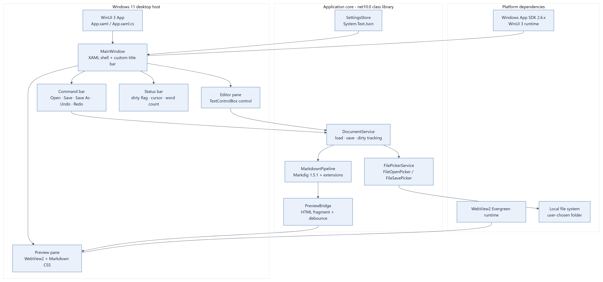
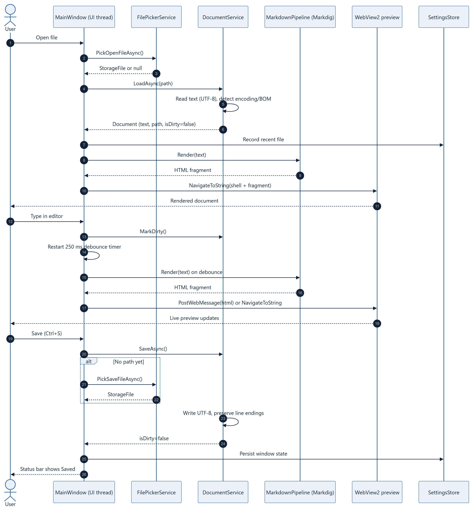

# 02 — Architecture

[← Requirements](01-Requirements.md) · [Contents](00-Contents.md) · [UX and Editor Design →](03-UX-and-Editor-Design.md)

---

## 1. Architectural goals

1. **One window, two panes, one document.** No tab host in v1, but the document surface is abstracted so tabs can be added without rewriting services.
2. **Rendering is a pure function.** Markdown text in, HTML fragment out. No UI types in the parser path, so it is unit-testable without a window.
3. **The UI thread owns all XAML.** File I/O, parsing and HTML generation happen off-thread, then marshal back exactly once per update.
4. **The app is a local document tool.** No network, no database, no service; settings are a small JSON file.
5. **Failure is visible.** Every I/O or parse failure produces a user-readable message and a log entry, not a silent empty pane.

## 2. Framework and window layout



*Print version: [PDF](Diagrams/application-framework-layout-affc92150eb44713901300492adbbc47/diagram.pdf) · source: [MMD](Diagrams/application-framework-layout-affc92150eb44713901300492adbbc47/diagram.mmd)*

The XAML shell is a `Grid` of four rows: custom title bar, command bar, document area, status bar. The document area is a `GridSplitter` between the editor host and the WebView2 preview host. Each host is a `UserControl`, so the shell never talks to a concrete editor control directly.

```
MainWindow (Window)
└── RootGrid (Grid: Auto / Auto / * / Auto)
    ├── TitleBar (custom, extends content into title bar)
    ├── CommandBar (Open, Save, Save As, Undo, Redo, Find, Layout)
    ├── DocumentArea (Grid: * / Auto / *)
    │   ├── EditorHost (EditorPane UserControl)
    │   ├── Splitter (GridSplitter)
    │   └── PreviewHost (PreviewPane UserControl → WebView2)
    └── StatusBar (dirty, line/col, words, encoding, zoom)
```

## 3. Solution structure (intended layout)

```
LumenMarkdown.sln
├── Directory.Build.props            # shared TFMs, nullable, analyzers, LangVersion
├── Directory.Packages.props         # central package versions (CPM)
├── global.json                      # pins SDK 10.0.403, rollForward latestPatch
├── src/
│   ├── LumenMarkdown.Core/          # net10.0 — no WinUI reference
│   │   ├── Documents/               # Document, DocumentState, encoding/line-ending logic
│   │   ├── Markdown/                # MarkdownPipelineFactory, PreviewDocument, sanitisation policy
│   │   ├── Settings/                # AppSettings, SettingsStore, RecentFiles
│   │   ├── IO/                      # IFileSystem, TextFileLoader/Writer, path guards
│   │   └── Logging/                 # IAppLogger + file logger
│   └── LumenMarkdown.App/           # net10.0-windows10.0.22000.0, WinUI 3
│       ├── App.xaml / App.xaml.cs
│       ├── MainWindow.xaml / .cs
│       ├── Views/                   # EditorPane, PreviewPane, FindBar, StartSurface
│       ├── ViewModels/              # MainViewModel, DocumentViewModel, SettingsViewModel
│       ├── Services/                # FilePickerService, WindowStateService, ThemeService, DispatcherService
│       ├── Assets/                  # placeholder icon, preview.css, preview shell template
│       └── app.manifest
├── tests/
│   └── LumenMarkdown.Core.Tests/    # xUnit — parser, encoding, settings, state machine
└── docs/                            # user-facing notes added during implementation
```

**D-6 — Two projects, not five.** A Core library and the WinUI app. Adding an `Infrastructure` project now would create ceremony without isolation benefit; I/O interfaces live in Core and their implementations in Core except pickers (WinUI-bound).

**D-7 — Central Package Management.** One `Directory.Packages.props` keeps Markdig, WebView2 and test packages on single versions.

**D-8 — `global.json` pins `10.0.403` with `rollForward: latestPatch`.** The host has 10.0.400/401; the plan requires installing 10.0.403 (or relaxing the pin) as a Phase 0 prerequisite, not an assumption.

## 4. Layer responsibilities

| Layer | Owns | Must not |
|-------|------|----------|
| `LumenMarkdown.App` (presentation) | XAML, view models, commands, pickers, window chrome, theme, WebView2 lifetime | Parse Markdown, touch files directly, hold document text as the source of truth |
| `LumenMarkdown.Core` (domain) | Document model and state machine, encoding detection, Markdown→HTML, settings, recent files, logging | Reference `Microsoft.UI.Xaml`, assume a UI thread, show dialogs |
| Platform | Windows App SDK runtime, WebView2 runtime, file system | — |

## 5. Document and rendering pipeline



*Print version: [PDF](Diagrams/document-lifecycle-32936d6450e34c03b7412e29b4626075/diagram.pdf) · source: [MMD](Diagrams/document-lifecycle-32936d6450e34c03b7412e29b4626075/diagram.mmd)*

### 5.1 Rendering path

1. Editor raises `TextChanged` → `DocumentViewModel.OnTextChanged` (UI thread) updates the in-memory string and marks dirty.
2. A `DispatcherQueueTimer` (250 ms, restarted on each keystroke) fires once the user pauses.
3. The view model snapshots the text and calls `MarkdownRenderer.RenderAsync(text, basePath, ct)`.
4. `MarkdownRenderer` runs on a background thread: Markdig pipeline → HTML fragment → wrapped in the preview shell template (CSS, CSP meta, base href).
5. The result returns to the UI thread; `PreviewPane` sends it to WebView2 via `PostWebMessageAsString` (preferred) or `NavigateToString` when the shell must be rebuilt.
6. WebView2 replaces the article content; scroll ratio is preserved.

**D-9 — `PostWebMessageAsString` for updates, `NavigateToString` for first load.** Re-navigating on every keystroke destroys scroll and selection; messaging keeps the document alive.

**D-10 — Debounce 250 ms, coalesce to one in-flight render.** If a render is running when new input arrives, mark `pending` and render once more after it completes; never queue unbounded work.

**D-11 — CSP in the preview shell.** `default-src 'none'; img-src file: data:; style-src 'unsafe-inline'; font-src file:`. This is defence in depth even with raw HTML disabled.

### 5.2 Why HTML in WebView2 rather than native XAML rendering

| Option | Verdict |
|--------|---------|
| Markdig → HTML in WebView2 | **Chosen.** Complete CommonMark fidelity, CSS typography, tables and task lists for free; WebView2 ships with Windows 11 |
| Markdig AST → `RichTextBlock` inlines | Rejected for v1: tables, nested lists and code blocks require hand-built layout; Community Toolkit's `MarkdownTextBlock` is a Labs experiment, not a supported NuGet control |
| Markdig → `FlowDocument` | WPF-only; not applicable to WinUI 3 |

## 6. Document state model

```
Closed ──Open──▶ Clean ──Edit──▶ Dirty ──Save──▶ Clean
                   │               │
                   │               └─SaveAs─▶ Clean (new path)
                   └──ExternalChange──▶ Stale ──Reload──▶ Clean
```

`Document` is immutable except for `Text`; `DocumentSession` holds `FilePath`, `OriginalTextHash`, `IsDirty`, `IsReadOnly`, `Encoding`, `LineEnding`. Dirty is computed from a content hash, not a boolean flag set by every keystroke, so undo back to the saved text correctly returns to clean.

**D-12 — Hash-based dirty tracking.** Prevents the "still dirty after undo" bug and makes save verification testable.

## 7. UI-thread ownership and concurrency

| Work | Thread | Rule |
|------|--------|------|
| XAML property changes, `ObservableCollection` updates | UI thread | Only via `DispatcherQueue.TryEnqueue` |
| File read/write | Thread pool (`File.ReadAllTextAsync`) | No UI types captured |
| Markdig parse + HTML wrap | Thread pool | Pure; cancellation token honoured between blocks |
| WebView2 `EnsureCoreWebView2Async`, messaging | UI thread | WebView2 objects are thread-affine |
| Settings save | Thread pool, debounced 500 ms | Atomic write (temp + replace) |
| Autosave draft | Thread pool, 60 s timer | Never blocks typing |

**Rules**
- No `.Result` / `.Wait()` on the UI thread.
- Every async command catches and reports; no `async void` except event handlers, which delegate to a `SafeExecuteAsync` wrapper.
- A render carries the document generation number; stale results are discarded.

## 8. Key components

| Component | Responsibility | Depends on |
|-----------|----------------|------------|
| `MainViewModel` | Commands, layout state, title, status | `DocumentSession`, `SettingsStore`, `FilePickerService` |
| `DocumentSession` | Text, path, dirty hash, encoding, read-only | `IFileSystem`, `TextFileLoader` |
| `MarkdownRenderer` | Markdig pipeline, extension set, shell wrap | Markdig |
| `PreviewPane` | WebView2 lifetime, message bridge, scroll sync | WebView2 SDK |
| `EditorPane` | Editor control adapter, find/go-to-line, highlighting | Editor control (see [03 §5](03-UX-and-Editor-Design.md)) |
| `SettingsStore` | Load/save JSON, migration by schema version | `System.Text.Json` |
| `FilePickerService` | `FileOpenPicker`/`FileSavePicker` with `InitializeWithWindow` | WinUI 3 |
| `ThemeService` | Light/dark/system, applies `RequestedTheme` | WinUI 3 |

## 9. Settings schema (v1)

`%LOCALAPPDATA%\LumenMarkdown\settings.json`

```json
{
  "schemaVersion": 1,
  "theme": "System",
  "editorFontSize": 14,
  "previewZoom": 1.0,
  "layout": "Split",
  "splitterRatio": 0.5,
  "wordWrap": true,
  "showLineNumbers": true,
  "window": { "x": 120, "y": 80, "width": 1280, "height": 820, "maximized": false },
  "recentFiles": ["C:\\docs\\spec.md"]
}
```

**D-13 — Source-generated JSON context** (`JsonSerializerContext`) so settings survive trimming/AOT experiments and fail loudly on schema drift. Corrupt settings are backed up as `settings.bad.json` and defaults are used.

## 10. Error handling and diagnostics

- `IAppLogger` writes to `%LOCALAPPDATA%\LumenMarkdown\logs\app-YYYYMMDD.log`, rolling 7 days, no document content.
- Unhandled UI exceptions are caught in `App.UnhandledException`, logged, and shown in a dialog that offers "Copy details".
- File errors map to stable messages: not found, access denied, too large, binary, encoding failure, disk full.
- Preview failures never blank the pane: the last good HTML stays, with an inline banner.

## 11. Security and privacy

- No network calls except the user opening an http(s) link, which is handed to the shell via `Launcher.LaunchUriAsync` after scheme validation.
- Raw HTML disabled; CSP applied; `WebView2.Settings.AreDevToolsEnabled = false` in Release, `IsWebMessageEnabled = true` only for our own navigation.
- Preview navigation to anything other than the internal shell is cancelled.
- Files are opened read/write only when the user chose Save; no background scanning of folders.
- No telemetry, no identifiers, no document content in logs.

## 12. Architectural decisions register

| ID | Decision | Alternative rejected |
|----|----------|----------------------|
| D-1 | Markdig HTML → WebView2 | Native XAML renderer |
| D-2 | JSON settings | SQLite/EF Core (user chose none) |
| D-3 | `net10.0-windows10.0.22000.0` | Windows 10 19041 min |
| D-4 | WinAppSDK self-contained, .NET framework-dependent | Fully self-contained (larger ZIP) |
| D-5 | No MVVM framework; minimal `ObservableObject` | CommunityToolkit.Mvvm dependency |
| D-6 | Two projects | Multi-project clean architecture |
| D-7 | Central Package Management | Per-project versions |
| D-8 | SDK pinned 10.0.403 | Float to installed 10.0.401 |
| D-9 | WebMessage updates | NavigateToString every keystroke |
| D-10 | 250 ms debounce + coalescing | Render every keystroke |
| D-11 | Strict CSP | Trusting generated HTML |
| D-12 | Hash-based dirty state | Boolean flag |
| D-13 | Source-generated JSON | Reflection serialisation |
| D-14 | Single window, single document | Tab host in v1 |
| D-15 | `IEditorAdapter` abstraction with `TextBox` → `TextControlBox` swap | Binding directly to one editor control |
| D-16 | .NET framework-dependent + Windows App SDK self-contained | Shipping the Windows App Runtime installer as the primary path |

## 13. Open architectural prerequisites

1. **Windows App SDK self-contained on unpackaged WinUI 3 must be proven** in Phase 0 (build + launch on a machine without the runtime). Until then D-4 is unverified.
2. **Editor control choice** is provisional until the Phase 0 spike and Phase 4 accessibility check ([03 §5](03-UX-and-Editor-Design.md)).
3. **SDK 10.0.403 vs installed 10.0.401** must be resolved by install or by pinning 10.0.401.
4. **WebView2 runtime presence** on Windows 11 is expected (Evergreen), but the app must detect a missing runtime and show a clear message rather than a blank pane.
