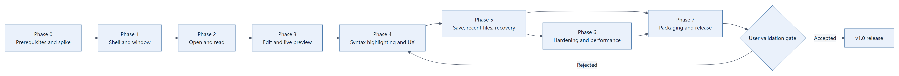

# 04 — Phased Implementation

[← UX and Editor Design](03-UX-and-Editor-Design.md) · [Contents](00-Contents.md) · [Testing →](05-Testing.md)

---

## How to read this manual

Every phase is a **small runnable slice**, not a layer. For each phase you get: outcome, tasks, files touched, commands to run later, observable UI checks, and a binary exit condition followed by a **user validation gate**. Nothing here has been executed — this is Plan Mode documentation.



*Print version: [PDF](Diagrams/phase-delivery-map-c0d45dd54f764456bd4ac64b5f816469/diagram.pdf) · source: [MMD](Diagrams/phase-delivery-map-c0d45dd54f764456bd4ac64b5f816469/diagram.mmd)*

**Global rules**

- A phase ends only when its exit condition is observed, not when it compiles.
- Capture diagnostics (build log, exception text, Event Viewer entry) **before** changing architecture.
- Keep the previous phase's slice working; no phase may regress an earlier exit condition.
- Each gate requires the user to look at the running app; the agent cannot self-approve a UX gate.

---

## Phase 0 — Prerequisites and technical spike

**Outcome:** a machine that can build and launch a minimal WinUI 3 window, and evidence for the three risky choices (self-contained WinAppSDK, editor control, WebView2 preview).

**Runnable slice:** a blank window titled "Lumen Markdown" that launches from `dotnet run` and from a published folder.

### Tasks
1. Verify SDK: `dotnet --list-sdks` shows `10.0.4xx`; install 10.0.403 or relax `global.json` to `latestFeature` with 10.0.401 (record which).
2. Create solution and projects (`LumenMarkdown.App`, `LumenMarkdown.Core`, `LumenMarkdown.Core.Tests`).
3. Set `TargetFramework=net10.0-windows10.0.22000.0`, `TargetPlatformMinVersion=10.0.22000.0`, `Platforms=x64`, `RuntimeIdentifier=win-x64`, `WindowsPackageType=None`, `WindowsAppSDKSelfContained=true`, `PublishSingleFile=false`.
4. Add `global.json`, `Directory.Build.props`, `Directory.Packages.props`; enable nullable, warnings-as-errors for Core, analyzers.
5. Spike A: publish the blank app to a folder; launch it on a machine/VM **without** the Windows App Runtime installed.
6. Spike B: drop a `TextControlBox` into a throwaway page; type 5 000 lines; open the accessibility tree with Narrator.
7. Spike C: WebView2 page that loads a bundled HTML shell from disk and receives one `postMessage`.
8. Record findings in `docs/spike-notes.md`: what worked, exact versions, failures with logs.

### Files
`LumenMarkdown.sln`, `global.json`, `Directory.Build.props`, `Directory.Packages.props`, `src/LumenMarkdown.App/LumenMarkdown.App.csproj`, `src/LumenMarkdown.App/App.xaml(.cs)`, `src/LumenMarkdown.App/MainWindow.xaml(.cs)`, `src/LumenMarkdown.App/app.manifest`, `docs/spike-notes.md`.

### Commands to run later
```powershell
dotnet --list-sdks
dotnet new list winui           # confirm a CLI template exists; otherwise use the VS "Blank App, Unpackaged" template
dotnet restore LumenMarkdown.sln
dotnet build LumenMarkdown.sln -c Debug -p:Platform=x64
dotnet run --project src/LumenMarkdown.App -p:Platform=x64
dotnet publish src/LumenMarkdown.App -c Release -r win-x64 --self-contained false -p:Platform=x64 -p:WindowsPackageType=None -p:WindowsAppSDKSelfContained=true -o artifacts/spike
```

### Observable UI checks
- A window appears with the correct title, resizes, and closes cleanly.
- Published folder launches on a machine with **no** WinAppSDK runtime installed (Spike A).
- The test editor accepts 5 000 lines of pasted text without a multi-second freeze; Narrator announces it as editable text.
- The WebView2 spike shows the bundled HTML and logs one received message.

### Exit condition
All three spikes have a written verdict in `docs/spike-notes.md`, and the published blank app launches on the clean VM. If Spike A fails, stop and resolve deployment strategy before Phase 1.

### User validation gate 0
User runs `artifacts/spike/LumenMarkdown.exe` on a clean Windows 11 x64 machine and confirms the window opens. **Approval required to proceed.**

---

## Phase 1 — Shell and window

**Outcome:** the real window chrome, theme, empty state and command surface, with no file I/O yet.

**Runnable slice:** app opens to the start surface; layout toggle and theme switch work; commands are disabled appropriately.

### Tasks
1. Build `MainWindow.xaml`: custom title bar, command bar, document grid, status bar.
2. Add `MainViewModel` with `ObservableObject` base, `RelayCommand`, and command enablement.
3. Add `ThemeService` (System/Light/Dark) and `SettingsStore` skeleton writing `settings.json`.
4. Implement `EditorPane` around `TextBox` (temporary) and `PreviewPane` placeholder with "Open a file to preview".
5. Start surface: drop zone, Open button, empty recent list, shortcut hints.
6. Add keyboard accelerators for all commands; wire layout toggle cycling Split/Editor/Preview.
7. Persist and restore window geometry and splitter ratio.
8. Add `IAppLogger` with rolling file output and a global unhandled-exception handler.

### Files
`MainWindow.xaml(.cs)`, `Views/StartSurface.xaml(.cs)`, `Views/EditorPane.xaml(.cs)`, `Views/PreviewPane.xaml(.cs)`, `ViewModels/MainViewModel.cs`, `ViewModels/ObservableObject.cs`, `Services/ThemeService.cs`, `Services/WindowStateService.cs`, `Core/Settings/*`, `Core/Logging/*`, `Assets/preview.css`.

### Commands to run later
```powershell
dotnet build LumenMarkdown.sln -c Debug -p:Platform=x64
dotnet run --project src/LumenMarkdown.App -p:Platform=x64
dotnet test tests/LumenMarkdown.Core.Tests -c Debug
```

### Observable UI checks
- Window opens at the last size/position; maximised state restores.
- Ctrl+Shift+P cycles three layouts; splitter drag persists after restart.
- Theme switch changes window and empty preview background immediately; restart keeps it.
- Open/Save are disabled with no document; Find is disabled.
- Closing writes `%LOCALAPPDATA%\LumenMarkdown\settings.json`; deleting it and relaunching falls back to defaults without a crash.
- 200 % text scale: no clipped command labels.

### Exit condition
Settings round-trip works, layout/theme persist, and no unhandled exception occurs in a 10-minute idle/Resize/theme-switch session.

### User validation gate 1
User confirms the visual shell matches [03](03-UX-and-Editor-Design.md) closely enough to build on, and approves the placeholder branding.

---

## Phase 2 — Open and read

**Outcome:** a real Markdown file opens from picker, drag-drop and command line, and renders faithfully in the preview.

**Runnable slice:** open `README.md`, read it rendered; editor shows raw source read-only.

### Tasks
1. `TextFileLoader`: encoding detection (BOM, UTF-8 validation, UTF-16), NUL-byte rejection, 10 MB guard, long/UNC path handling.
2. `FilePickerService` with `InitializeWithWindow`; filters `.md;.markdown;.txt`.
3. `DocumentSession` state machine: Closed/Clean/Dirty/Stale, hash-based dirty flag.
4. `MarkdownRenderer` with Markdig pipeline: CommonMark + advanced extensions, `DisableHtml`, YAML front-matter, soft/hard line breaks per CommonMark.
5. Preview shell HTML template + `preview.css` + CSP; relative-path `base href`; missing-image placeholder.
6. Wire drop target, command-line argument, and File > Open; info bars for each error state.
7. Read-only detection (`FileAttributes.ReadOnly`) and read-only badge.
8. Unit tests: encoding matrix, line-ending preservation, HTML escaping, extension output.

### Files
`Core/IO/TextFileLoader.cs`, `Core/IO/IFileSystem.cs`, `Core/Documents/DocumentSession.cs`, `Core/Markdown/MarkdownRenderer.cs`, `Core/Markdown/PreviewTemplate.cs`, `Services/FilePickerService.cs`, `Views/PreviewPane.xaml(.cs)`, `Assets/preview.css`, `tests/LumenMarkdown.Core.Tests/MarkdownTests.cs`, `EncodingTests.cs`.

### Commands to run later
```powershell
dotnet test tests/LumenMarkdown.Core.Tests -c Debug --filter "Category=Core"
dotnet run --project src/LumenMarkdown.App -p:Platform=x64 -- "C:\samples\README.md"
```

### Observable UI checks
- Open a 1 MB README: headings, tables, task lists, code fences and block quotes render with the intended typography.
- CRLF and LF files both display without doubled blank lines; save later preserves the original ending.
- A UTF-8 BOM file shows no `` characters.
- An image with a relative path resolves against the document folder; a missing image shows alt text.
- Opening a `.exe` shows "This doesn't look like a text file", not garbage.
- A read-only file shows the badge and leaves Save disabled.

### Exit condition
The five Markdown fixture files in `tests/fixtures/markdown/` render with expected structure, and every error state has a visible message.

### User validation gate 2
User opens three of their own Markdown files and confirms rendering fidelity, especially tables, code blocks and relative images.

---

## Phase 3 — Edit and live preview

**Outcome:** editing with an updating preview, without losing scroll, focus or responsiveness.

**Runnable slice:** type in the left pane, watch the right pane follow within 300 ms.

### Tasks
1. Make the editor editable; two-way binding to `DocumentViewModel.Text` with a guard against re-entrancy.
2. Debounced render pipeline (250 ms) with generation numbers and single in-flight render.
3. WebView2 bridge: first load `NavigateToString`, subsequent updates `PostWebMessageAsString` + `innerHTML` swap.
4. Preserve scroll ratio across updates; restore caret and selection in the editor.
5. Cancellation on rapid typing, document switch and window close.
6. Dirty state via content hash; title bullet and status bar update.
7. Basic preview typography pass and theme propagation (`data-theme`).
8. Tests: renderer determinism, debounce coalescing (time abstraction), dirty hash round-trip.

### Files
`ViewModels/DocumentViewModel.cs`, `Core/Markdown/MarkdownRenderer.cs`, `Views/PreviewPane.xaml(.cs)`, `Views/EditorPane.xaml(.cs)`, `MainWindow.xaml.cs`, `Assets/preview.js`, `tests/LumenMarkdown.Core.Tests/RenderPipelineTests.cs`.

### Commands to run later
```powershell
dotnet build LumenMarkdown.sln -c Debug -p:Platform=x64
dotnet run --project src/LumenMarkdown.App -p:Platform=x64 -- "C:\samples\long.md"
dotnet test tests/LumenMarkdown.Core.Tests -c Debug
```

### Observable UI checks
- Typing a paragraph updates the preview once the user pauses; no flicker, no scroll jump to top.
- Holding a key down for 5 s keeps the UI responsive; preview settles after release.
- Scrolling mid-edit keeps the preview at the same relative position.
- Switching theme does not reload the document or lose the caret.
- Closing mid-render does not throw (`ObjectDisposedException` absent from log).

### Exit condition
Measured keystroke-to-preview p95 ≤ 300 ms on a 100 KB document; no stale render overwrites a newer one.

### User validation gate 3
User edits a real document for five minutes and confirms the preview feels live and the caret never jumps.

---

## Phase 4 — Syntax highlighting and editing UX

**Outcome:** Markdown source highlighting, line numbers, find, go-to-line and the final editor control decision.

**Runnable slice:** open a document and see coloured Markdown with a line gutter; Ctrl+F finds text.

### Tasks
1. Decide the editor control: run the Phase 0 matrix against `TextControlBox` 1.7.x and `RichEditBox`; score API stability, 1 MB performance, Narrator support, licence.
2. Implement `IEditorAdapter`; bind the chosen control; keep the other as fallback behind a feature flag.
3. Line-number gutter and current-line highlight.
4. Markdown token classifier for headings, emphasis, links, code, lists, quotes, rules; theme brushes.
5. Find bar with match count, next/previous, case toggle, Esc restore.
6. Go-to-line input with range validation.
7. Word count (debounced), caret line/column.
8. Keyboard accelerators verified against IME input and RTL text.
9. Tests: token classifier table-driven cases; find next/previous wrap-around.

### Files
`Views/EditorPane.xaml(.cs)`, `Services/Editor/IEditorAdapter.cs`, `Services/Editor/TextControlBoxAdapter.cs`, `Services/Editor/RichEditBoxAdapter.cs`, `Core/Editing/MarkdownTokenizer.cs`, `Views/FindBar.xaml(.cs)`, `tests/LumenMarkdown.Core.Tests/TokenizerTests.cs`.

### Commands to run later
```powershell
dotnet build LumenMarkdown.sln -c Debug -p:Platform=x64
dotnet test tests/LumenMarkdown.Core.Tests -c Debug --filter "Category=Editor"
dotnet run --project src/LumenMarkdown.App -p:Platform=x64 -- "C:\samples\showcase.md"
```

### Observable UI checks
- Headings, bold, links, inline code and fenced code are visually distinct in both themes.
- Gutter numbers align with wrapped lines (or wrap is clearly indicated).
- Ctrl+F finds all matches, wraps, and reports "3 of 17"; Esc restores the caret.
- Ctrl+G rejects `0`, `abc` and out-of-range values with a gentle inline message.
- Narrator reads the editor content and announces selection changes.
- Pasting 1 MB of text completes without a UI freeze > 1 s.

### Exit condition
The chosen editor passes the accessibility and 1 MB checks; highlighting is correct for the token fixture set. If no third-party control passes, the documented fallback (`RichEditBox`, reduced highlighting) is approved and recorded.

### User validation gate 4
User reviews the highlighting palette and find/go-to-line behaviour, and accepts the editor control decision (or rejects it, returning to Phase 3/4 with the fallback).

---

## Phase 5 — Save, recent files, recovery

**Outcome:** a complete document lifecycle: save, Save As, dirty prompts, recents, external-change detection, autosave recovery.

**Runnable slice:** edit, save, restart, reopen from recents, recover after a forced kill.

### Tasks
1. `TextFileWriter`: atomic write (temp file + replace), preserve encoding and line endings, handle read-only/disk-full.
2. Save / Save As with picker defaults; untitled-document naming (`Untitled.md`).
3. Dirty-close prompt (Save / Discard / Cancel) on window close, document close and Open-over-current.
4. Recent files: add, dedupe, cap 10, prune missing, persist; start-surface list.
5. External change detection via `FileSystemWatcher` (debounced) + `LastWriteTimeUtc` comparison; Stale state and Reload banner.
6. Autosave draft every 60 s to `%LOCALAPPDATA%\LumenMarkdown\drafts\`; recovery prompt on launch; draft deleted on clean save/close.
7. Settings schema versioning and corruption fallback (`settings.bad.json`).
8. Tests: atomic write, CRLF preservation, dirty prompt state transitions, recent-file pruning, draft recovery.

### Files
`Core/IO/TextFileWriter.cs`, `Core/Documents/DocumentSession.cs`, `Core/Settings/RecentFiles.cs`, `Services/FileWatcherService.cs`, `Services/DraftService.cs`, `ViewModels/MainViewModel.cs`, `Views/Dialogs/UnsavedChangesDialog.xaml(.cs)`, `tests/LumenMarkdown.Core.Tests/SaveTests.cs`, `RecoveryTests.cs`.

### Commands to run later
```powershell
dotnet test tests/LumenMarkdown.Core.Tests -c Debug
dotnet run --project src/LumenMarkdown.App -p:Platform=x64 -- "C:\samples\save-me.md"
```

### Observable UI checks
- Ctrl+S writes the file; dirty dot clears; byte comparison shows only intended edits.
- Save As to a new folder updates title and recents.
- Close with edits shows three options; Cancel keeps the document and the caret.
- Kill the process with Task Manager after editing; relaunch offers the draft; accepting restores text.
- Edit the file in Notepad while open; app shows the external-change banner.
- Delete a recent file; clicking it shows "Not found" and removes it from the list.
- Corrupt `settings.json` by hand; app starts with defaults and writes `settings.bad.json`.

### Exit condition
Every save/close/recovery path above behaves as described, with no data loss in the forced-kill test.

### User validation gate 5
User performs a full edit → save → close → reopen cycle on their own file and confirms no content or line-ending damage.

---

## Phase 6 — Hardening and performance

**Outcome:** the app survives ugly inputs and meets the non-functional targets.

**Runnable slice:** the full feature set running against the stress corpus without crashes or unacceptable latency.

### Tasks
1. Stress corpus: 1 MB, 10 MB, 50 000-line, deeply nested lists, 5 000 tables, malformed Markdown, mixed encodings, emoji/RTL, very long single line, 200 images.
2. Fix rendering cliffs: cap nesting depth, cap table width, virtualise/limit preview updates, disable sync scroll above a size threshold with a notice.
3. Measure NFR-01…NFR-05 with instrumentation; record results in `docs/performance.md`.
4. Memory pass: WebView2 disposal on document close, event unsubscription, no leaked `DocumentSession`.
5. Accessibility audit: keyboard-only walkthrough, Accessibility Insights, high-contrast theme.
6. DPI matrix: 100/150/200 %, mixed-DPI dual monitor, window drag between monitors.
7. Failure injection: read-only folder, disk full (small VHD), file locked by another process, missing WebView2, revoked permission mid-session.
8. 30-minute soak script (open/type/scroll/toggle/close repeatedly); zero unhandled exceptions.
9. Triage and fix P1/P2 defects; log P3s for v1.1.

### Files
`docs/performance.md`, `docs/accessibility-audit.md`, `Core/Markdown/MarkdownRenderer.cs` (limits), `Views/PreviewPane.xaml.cs` (disposal), `Services/*` (unsubscription), test fixtures under `tests/fixtures/stress/`.

### Commands to run later
```powershell
dotnet build LumenMarkdown.sln -c Release -p:Platform=x64
dotnet test tests/LumenMarkdown.Core.Tests -c Release
dotnet run --project src/LumenMarkdown.App -c Release -p:Platform=x64 -- "C:\stress\1mb.md"
```

### Observable UI checks
- 1 MB file: open ≤ 1 s, typing has no perceptible lag, memory ≤ 350 MB.
- 10 MB file: warns and opens read-only; UI remains usable.
- Malformed Markdown renders as text rather than throwing.
- High-contrast theme keeps all text readable; focus rectangles visible.
- Dragging the window between 100 % and 200 % monitors does not blur or clip.
- Soak run leaves `logs\` free of errors.

### Exit condition
NFR-01…NFR-05 measured within target on the reference machine, accessibility audit has no blockers, and the soak run is clean.

### User validation gate 6
User runs the stress files on their own hardware and accepts the measured performance, or names the specific case that must improve.

---

## Phase 7 — Packaging and release

**Outcome:** a signed-off portable ZIP that runs on a clean Windows 11 x64 machine.

**Runnable slice:** unzip on a clean VM, launch, open/save a file, close.

### Tasks
1. Release build with `WindowsPackageType=None`, `WindowsAppSDKSelfContained=true`, `--self-contained false`, `win-x64`.
2. Add `app.manifest` (PerMonitorV2 DPI, `longPathAware`, supportedOS Windows 10/11), version info, placeholder icon.
3. Trim publish output: remove pdb/xml docs, keep required WinAppSDK/WebView2 natives; verify no missing DLLs.
4. Produce `LumenMarkdown-1.0.0-win-x64.zip` with `LumenMarkdown.exe`, dependencies, `LICENSE`, `THIRD-PARTY-NOTICES.md`, `README.txt` (prerequisite: .NET 10 Desktop Runtime), `CHANGELOG.md`.
5. Compute SHA-256; write release notes with known limitations.
6. Clean-VM test: install only the .NET 10 Desktop Runtime; run the full acceptance checklist.
7. Rollback rehearsal: keep previous ZIP, document restore (replace folder, settings survive because they live in `%LOCALAPPDATA%`).
8. Tag the repo `v1.0.0`; archive artifacts.

### Files
`src/LumenMarkdown.App/LumenMarkdown.App.csproj` (publish properties), `app.manifest`, `Packaging/README.txt`, `Packaging/THIRD-PARTY-NOTICES.md`, `CHANGELOG.md`, `scripts/publish.ps1` (optional), `artifacts/LumenMarkdown-1.0.0-win-x64.zip`.

### Commands to run later
```powershell
dotnet publish src/LumenMarkdown.App -c Release -r win-x64 --self-contained false -p:Platform=x64 -p:WindowsPackageType=None -p:WindowsAppSDKSelfContained=true -p:PublishReadyToRun=false -o artifacts/publish/win-x64
Compress-Archive -Path artifacts/publish/win-x64/* -DestinationPath artifacts/LumenMarkdown-1.0.0-win-x64.zip
Get-FileHash artifacts/LumenMarkdown-1.0.0-win-x64.zip -Algorithm SHA256
```

### Observable UI checks
- ZIP extracts to any folder (including a path with spaces) and launches.
- First run creates settings and logs under `%LOCALAPPDATA%\LumenMarkdown` without admin rights.
- Open, edit, save, close and reopen work on the clean VM.
- Uninstalling = delete folder; no registry residue required for operation.

### Exit condition
The clean-VM run passes [10-Acceptance-Checklist.md](10-Acceptance-Checklist.md) with only the .NET 10 Desktop Runtime installed, and the SHA-256 is published.

### User validation gate 7 (release gate)
User runs the ZIP on a clean machine, signs the acceptance checklist, and explicitly authorises release. No release without this signature.

---

## Phase summary

| Phase | Slice | Gate question |
|-------|-------|---------------|
| 0 | Blank window + spikes | Does it launch without the runtime? Which editor? |
| 1 | Shell, theme, layout | Is this the right frame to build in? |
| 2 | Open and render | Does your real Markdown look right? |
| 3 | Edit with live preview | Does typing feel live? |
| 4 | Highlighting, find, go-to-line | Is the editing experience acceptable? |
| 5 | Save, recents, recovery | Is your data safe? |
| 6 | Hardening, performance | Is it fast and stable enough? |
| 7 | ZIP release | Do you authorise v1.0? |

Machine-readable version with per-phase verification arrays: [phase-plan.json](phase-plan.json).
